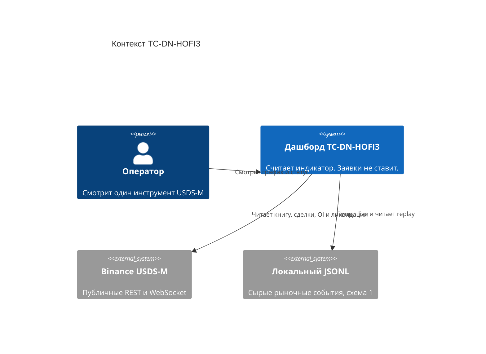
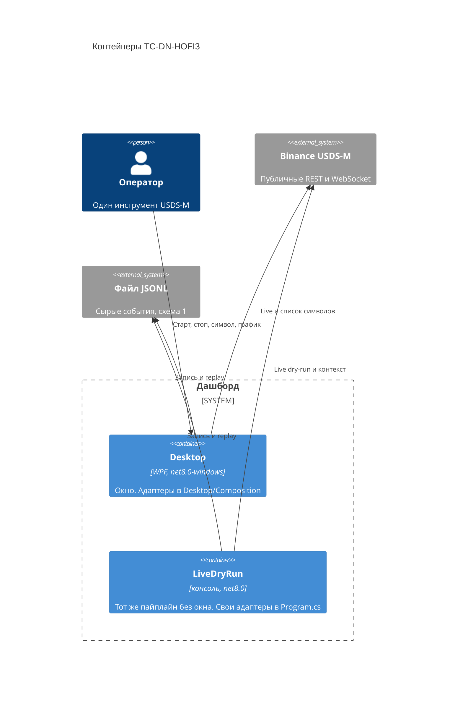
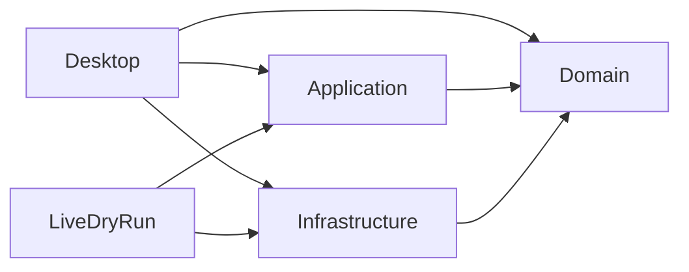
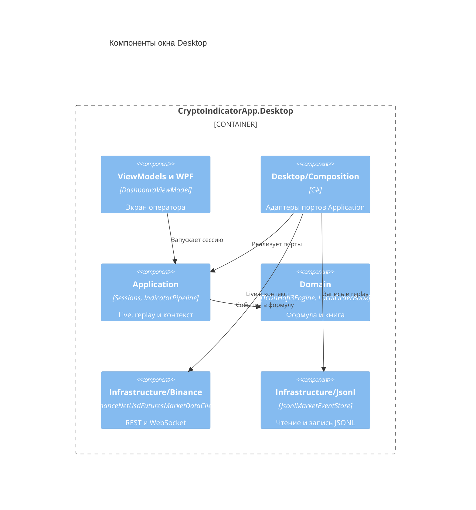
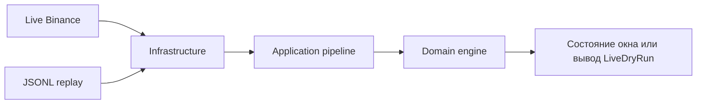

# Архитектура

Карта C4 для TC-DN-HOFI3 в том виде, в каком она собрана сейчас. Публичные типы читай в коде. Здесь связи, которых не видно из одного файла.

Решение 2026-05-28: один процесс WPF на .NET 8. Application зависит только от Domain. Desktop собирает Infrastructure. Текст: [checkpoint](thread-checkpoints-2026-10-02.md#approved-product-and-architecture). Рядом с окном есть консольный `tools/LiveDryRun`: тот же пайплайн, отдельные копии адаптеров.

## Контекст

Оператор смотрит один инструмент USDS-M. Система считает TC-DN-HOFI3 и заявки не ставит. Снаружи публичные REST и WebSocket Binance и локальный файл JSONL. `tools/Memory` и `tools/PilotB` к этой системе не относятся.

## Контейнеры

Два процесса гоняют один индикаторный пайплайн. Domain, Application и Infrastructure — библиотеки внутри этих процессов, не отдельные сервисы.

`tools/LiveDryRun` гоняет replay там, где окно WPF не запускается. Ограничения Linux: [AGENTS.md](../AGENTS.md), раздел Cursor Cloud.

## Компоненты

Стрелка на схеме — прямая `ProjectReference`. Application не ссылается на Infrastructure. Infrastructure не ссылается на Application: у него в проекте только Domain.

В `CryptoIndicatorApp.Desktop/Composition` лежат `BinanceLiveMarketEventSource`, `BinanceContextDataSource`, `JsonlMarketEventRecorder`, `JsonlMarketEventSource` и `BinanceProxyOptionsMapper`.

У `tools/LiveDryRun` общего проекта адаптеров нет. `Program.cs` держит свои `LiveSourceAdapter`, `JsonlRecorderAdapter`, `JsonlSourceAdapter` и `ContextSmokeDataSource`. Они вызывают те же типы Infrastructure и те же сессии Application.

Список символов окно собирает само: `MainWindow` создаёт `BinanceNetUsdFuturesMarketDataClient` напрямую, не через `Desktop/Composition`.

## Поток

Live и replay подают одни и те же внутренние события в один `IndicatorPipeline`. Контекст открытого интереса и ликвидаций идёт отдельной сессией `ContextModuleSession`, не через JSONL replay.

## Границы

- Не вызывать REST на горячем пути расчёта глубины и сделок. Снимок книги и ресинк — только для сборки локальной книги.
- Не ссылаться на Infrastructure из Application. Адаптеры JSONL и Binance собираются в Desktop или в другом внешнем хосте.
- Не показывать DTO клиента Binance в Domain. Пакет `Binance.Net` подключён в Infrastructure и транзитивно виден проектам, которые на него ссылаются.
- Конверт JSONL приватный внутри `JsonlMarketEventStore`. Схема 1. Снаружи ходят доменные события, включая биржевые идентификаторы обновлений и сделок.
- Сгенерированные экспорты памяти и графа не коммитить, пока их схема не одобрена.
